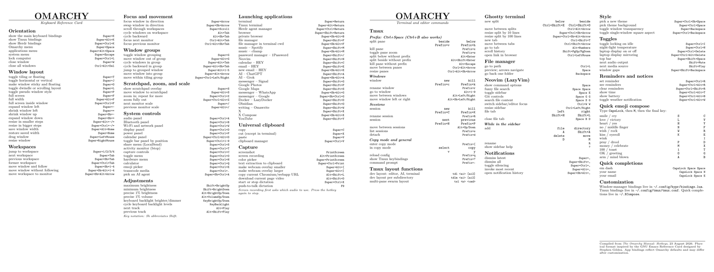

# Omarchy Keyboard Reference Card

[Omarchy](https://omarchy.org/) has a lot of excellent shortcuts. Remembering
all of them is another matter.

This project puts the useful ones on a beautifully typeset, six-panel keyboard
reference card you can print, fold, and keep beside your keyboard.

Its retro look reaches past pixel art and gaming nostalgia to the technical
reference cards of the late 1980s and early 1990s: dense, restrained,
typographic, and made to live beside a keyboard. Built in LaTeX on top of Donald
Knuth's TeX, it is designed first as a printed object—not merely a PDF.

**Download the printable PDF:**

- [US Letter](https://github.com/peterba/omarchy-ref-card/releases/latest/download/omarchy-reference-card-letter.pdf)
- [A4](https://github.com/peterba/omarchy-ref-card/releases/latest/download/omarchy-reference-card-a4.pdf)

[](https://github.com/peterba/omarchy-ref-card/releases/latest/download/omarchy-reference-card-letter.pdf)

*Both sides of the US Letter card; the A4 edition uses the same six-panel
layout.*

Print in landscape at 100%, double-sided, flipping on the short edge. Use the
PDF made for your paper size so the three folding panels line up correctly.

## What is on the card?

The card is a compact, two-sided guide to Omarchy's window management, system
controls, application launchers, capture tools, themes, Tmux, Ghostty, Neovim,
and more. It complements the official
[Omarchy Hotkeys manual](https://learn.omacom.io/2/the-omarchy-manual/53/hotkeys)
with something you can hold in your hands.

- Native layouts for US Letter and A4 paper
- Six panels designed to fold into thirds
- Curated defaults that are checked against Omarchy upstream
- Personal overrides that stay separate from project updates
- LaTeX sources and reproducible builds

## Make it yours

Create a private, Git-ignored customization file and list the available binding
IDs:

```sh
make personalize
make list-bindings
```

For example, `personalize.tex` can replace a shortcut without changing the
distributed defaults:

```tex
\SetBinding{notes}{Super+Shift+J}{notes -- Joplin}
```

See [Customizing the card](docs/CUSTOMIZING.md) for bindings, personal rows,
fonts, titles, and the complete customization API.

## Build from source

Install [Tectonic](https://tectonic-typesetting.github.io/) and run:

```sh
make
```

The Letter and A4 PDFs are written to `build/`. `make check` verifies both
two-page documents; `make render` creates page images for visual inspection.
Poppler's `pdfinfo` and `pdftoppm` are required for those checks.
Build only one paper size with `make letter` or `make a4`.

## Kept current

Omarchy evolves, and the card is intended to evolve with it. Automated checks
compare its curated bindings with a pinned upstream revision, while a weekly
drift check flags newer changes for review. See
[Maintaining the card](docs/MAINTAINING.md) for the audit and release workflow,
or [Contributing](CONTRIBUTING.md) to help.

## Inspiration and license

The physical format is inspired by Stephen Gildea's classic
[GNU Emacs Reference Card](https://www.gnu.org/software/emacs/refcards/pdf/refcard.pdf).
This project has an independent LaTeX implementation and does not incorporate
the GNU card's TeX or Emacs binding content.

The project is available under the [MIT License](LICENSE), matching Omarchy's
license. See [Third-party notices](THIRD_PARTY_NOTICES.md) for provenance and
font licensing.
